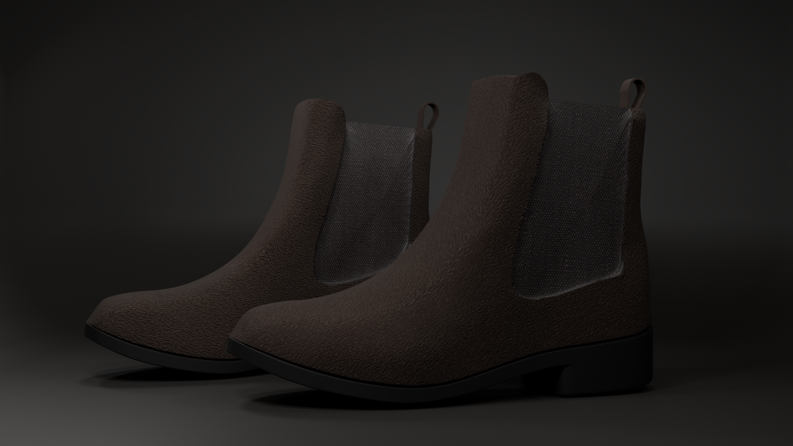
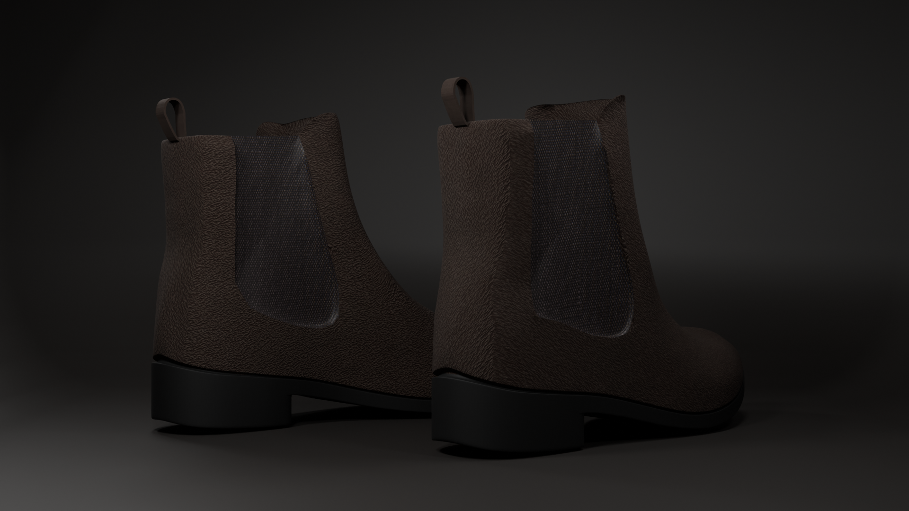

# Chelsea Boots | 3D Product Visualization

A realistic brown suede Chelsea boots project created in Blender, focusing on hard-surface modelling, material creation, UV mapping, sculpting, and studio product visualization.

## Project Overview

This project features a pair of Chelsea boots with a brown suede finish, dark elastic side panels, and black rubber soles.

The goal was to create a realistic footwear model with attention to material definition, shape, and small surface details.

## Features

- Separate left and right boot models
- Brown suede leather material
- Elastic fabric side panels
- Black rubber soles and heels
- Custom UV mapping
- Sculpted surface details
- Studio product rendering

## Software

- Blender

## Renders

### Main Render

### Additional Render

## Project Details

**Project Type:** 3D Modelling & Product Visualization

**Category:** Footwear

**Created by:** Gursehbaj Singh

**Software:** Blender

---

*Personal 3D art portfolio project.*
